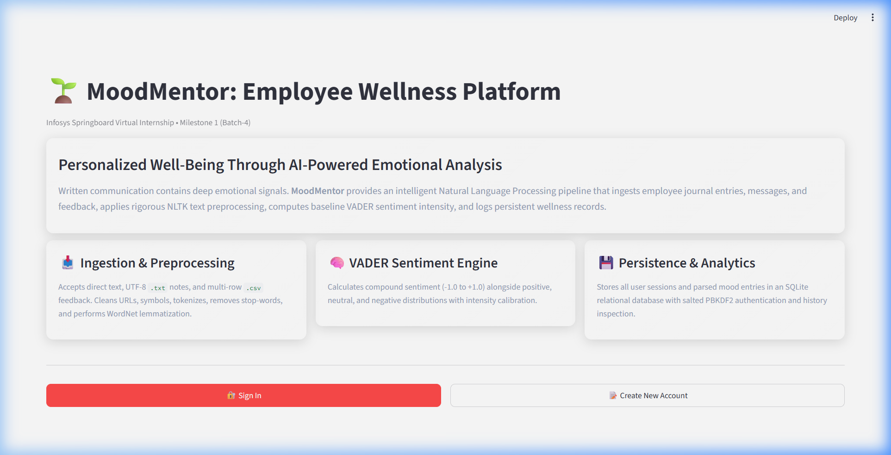
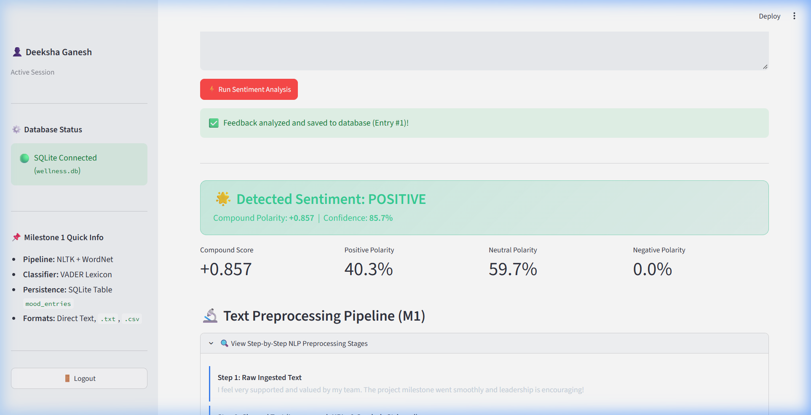
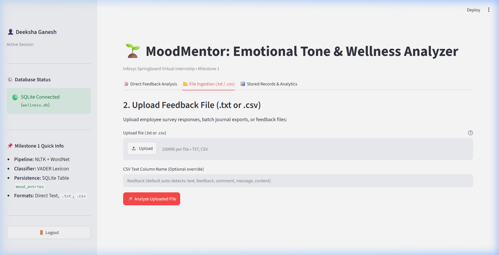
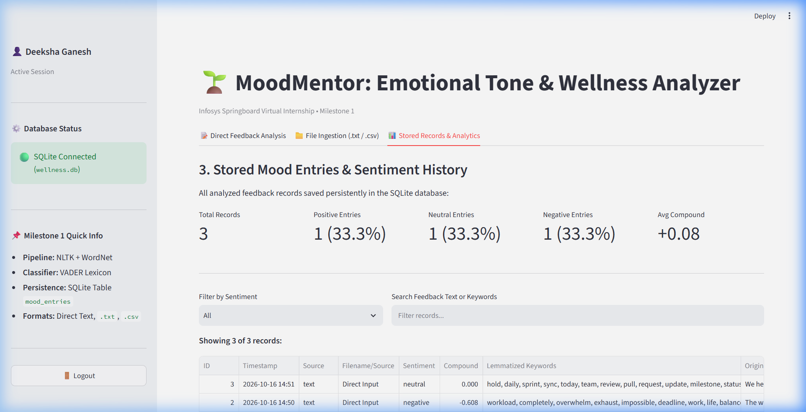

#  MoodMentor: AI-Powered Employee Wellness Platform


> **Infosys Springboard Virtual Internship — Milestone 1**  
> **Student:** Deeksha G ([@DeekshaG96](https://github.com/DeekshaG96)) • **Report:** [Milestone 1 Documentation PDF](docs/Milestone1_Documentation.pdf)

**MoodMentor** analyzes emotional signals from workplace feedback (journal entries, 1-on-1s, survey exports, and chat) using a standardized NLP preprocessing pipeline, baseline VADER sentiment scoring, and persistent SQLite storage within a modern 3-tab Streamlit application.

---

##  Quickstart

```bash
# 1. Clone repository
git clone https://github.com/DeekshaG96/AI_Based_Employee_Wellness_Management_Platform.git
cd AI_Based_Employee_Wellness_Management_Platform

# 2. Setup environment & dependencies
python -m venv .venv
.venv\Scripts\activate   # Linux/macOS: source .venv/bin/activate
pip install -e ".[dev,ui]"
python -m wellness.cli --download-nltk-data

# 3. Launch application
streamlit run app.py
```
Open **`http://localhost:8501`** in your browser.

---

## 🌟 Key Features

| Tab | Feature | Description |
| :--- | :--- | :--- |
| **Tab 1** | **Direct Feedback Analysis** | Instant text analysis with positive/negative/neutral presets, compound score gauge, 4-metric score cards, and step-by-step NLTK preprocessing breakdown with keyword chips. |
| **Tab 2** | **File Ingestion & Benchmark** | Upload `.txt`/`.csv` files or 1-click load the curated **60-row Kaggle-standard workplace wellness dataset** (`data/employee_wellness_dataset.csv`). |
| **Tab 3** | **Stored Records & Analytics** | Interactive SQLite database view with 5 aggregate KPIs (Total Records, % Positive, % Neutral, % Negative, Avg Compound), sentiment filters, and search. |

---

## 📸 Screenshots

| 1. Landing & Authentication | 2. Direct Feedback Analysis |
| :---: | :---: |
|  |  |
| **3. File Ingestion & Benchmark** | **4. Stored Records & Analytics** |
|  |  |

---

## 🧪 Testing & Code Quality

```bash
pytest        # Run all 15 unit and integration tests (100% passing)
ruff check .  # Verify linting and formatting (clean)
```

---

## 📂 Project Structure

```text
AI_Based_Employee_Wellness_Management_Platform/
├── app.py                         # Streamlit 3-tab web dashboard
├── wellness/                      # Ingestion, NLP preprocessing, VADER pipeline, SQLite storage
├── data/                          # Curated 60-row Kaggle workplace wellness dataset (.csv)
├── tests/                         # 15 automated pytest test cases
├── docs/                          # Official Milestone 1 PDF report & execution screenshots
└── pyproject.toml                 # Package configuration & dependencies
```

---

## 📄 License & Contributing

Distributed under the [MIT License](LICENSE). Review [CONTRIBUTING.md](CONTRIBUTING.md) and [SECURITY.md](SECURITY.md) for guidelines.
